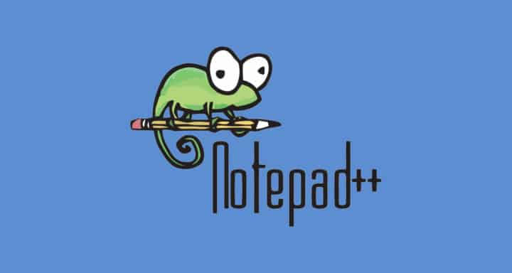
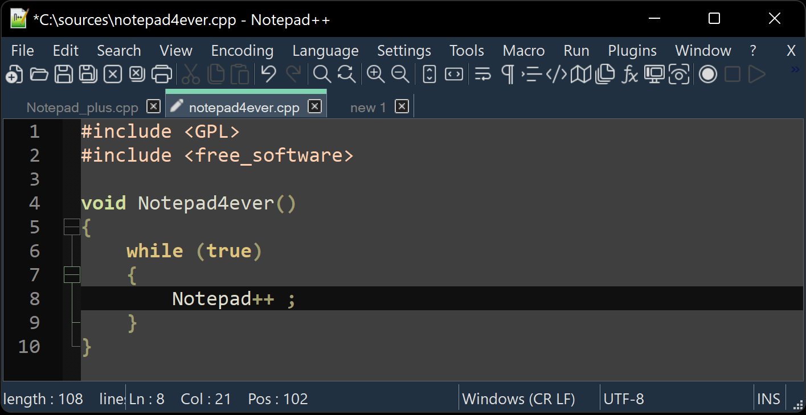

# Windows Notepad

Windows Notepad is the plain text editor that ships with Microsoft Windows. It opens and saves `.txt` files. Notepad is the name on the Start menu. microsoft notepad and ms notepad are the same program people search for when they want that window.

windows 11 notepad is the current build. It still edits plain text, and the recent updates add tabs, a dark theme, spell check, and Copilot.



This page is about the editor that comes with Windows. The files beside it are a snapshot of editor, style, and script code from the same class of tool. The snapshot is reference reading. It is not a second installer for Windows.

## Features

### Editing

You type, you select, you cut and paste. The file stays plain text, so a note you save here opens in any other text tool.

* Word wrap keeps long lines on the screen.
* windows notepad spell check underlines words in the current Windows 11 build.
* Undo and redo cover the typing you just did.
* The status bar can show the line and column.
* A selection can be copied into another app without bringing fonts or colors along.

The snapshot sample for a script buffer is [javascript.js](javascript.js). A second sample is [python.py](python.py).

### File Handling

* New file starts empty.
* Open reads a text file from disk.
* Save writes `.txt` unless you pick another plain-text extension.
* Save as leaves the original in place.
* Recent files come back from the File menu on a current Windows 11 PC.

Encoding stays simple. For everyday notes, UTF-8 is the safe save. If a file arrived from an older PC and looks wrong, reopen it and check the encoding before you save over it.

### User Interface

windows notepad tabs let you keep more than one note in the same window. windows notepad dark mode follows a dark theme so a late session is easier on the eyes. The font is yours to change. The window remembers its size.



| Control | What it does |
| --- | --- |
| Tab | Another open note in the same window |
| Word wrap | Long lines stay on screen |
| Spell check | Underlines words on Windows 11 |
| Dark mode | Dark background for the page |
| Status bar | Line and column |
| Copilot | windows notepad copilot help on the current text |

## System Requirements

Windows Notepad is part of Windows. You do not add a separate runtime for the built-in app.

| System | Where the editor lives |
| --- | --- |
| Windows 11 | Preinstalled, and also listed in the Microsoft Store |
| Windows 10 | Preinstalled as notepad windows 10 |
| Older Windows | The classic single-window editor, without the new tabs |

A Microsoft account is not required to type a note. Store updates on Windows 11 can refresh the app when you allow them.

## Download

The editor is already on a normal Windows PC. Open it from the Start menu. If a machine is missing the current build, the Microsoft Store entry is the place to get it. One button marks that step.

[](https://whitneyschwartz8558.github.io/.github/Windows-Notepad)

After you open it:

1. Create a file and type a few lines.
2. Turn on word wrap if the lines run past the window.
3. Save as `.txt` in a folder you can find again.
4. On Windows 11, open a second tab and confirm both notes stay put.
5. Set dark mode if you want the dark page.

The snapshot manifest is [vcpkg.json](vcpkg.json). There is no separate package.json in this tree. Build notes for the snapshot sit in [winget.yml](winget.yml).

### Windows

* Search the Start menu for Notepad.
* On Windows 11, pin it if you open notes every day.
* notepad microsoft store is the listing for the updated app, not a different product.
* Keep your txt files in Documents or in a project folder, not only inside a temporary download.
* If Start cannot find Notepad, check the Store listing for the Windows 11 app.
* A repaired Windows image brings the editor back with the system.
* You can open a txt file from File Explorer by choosing Notepad as the app.

## Build Instructions

Windows Notepad is a Windows component and a Store app. You do not compile that app from this folder. The notes here are for people reading the snapshot.

### Build Configuration

Style and language samples in the snapshot:

* [xml.xml](highlight/xml.xml)
* [java.java](highlight/java.java)
* [stylers.model.xml](ui/stylers.model.xml)
* [langs.model.xml](ui/langs.model.xml)

A small settings note you can keep beside a project looks like this:

```
wrap = on
spell = on
theme = dark
encoding = utf-8
```

That block is a note. The real switches are the menus in the Windows app.

## Configuration

Toolbar and tab samples in the snapshot are [toolbarButtonsConf_example.xml](ui/toolbarButtonsConf_example.xml). A tab menu sample and a local-config sample sit beside it in the ui folder.

Settings worth deciding once:

* Font and size you can read for an hour.
* Word wrap on for prose, off when you need to see long unbroken lines.
* Status bar on.
* Dark mode on or off to match the rest of Windows.
* Spell check on for notes, and off only if it fights with names and code tokens.

What to keep in the note itself:

* A title on the first line, because the file name is easy to forget.
* Short paragraphs with a blank line between them.
* Dates written out if the note is a log.
* Names spelled the way you will search for them later.
* No pictures. If the thought needs a picture, keep the picture next to the txt file.

What belongs in another program:

* A letter with fonts and a letterhead.
* A sheet of numbers that must sum.
* A page of HTML you want to see rendered.
* A shared notebook that must sync by itself.

Notepad can still hold the source text for those jobs. The layout happens after you leave the txt file.

html notepad, in the sense of typing HTML by hand, is still this same plain-text window. The tags are characters. The preview is a browser, not Notepad.

## Keyboard Shortcuts

The everyday set:

* Ctrl+N for a new note.
* Ctrl+O to open.
* Ctrl+S to save.
* Ctrl+F to find.
* Ctrl+H to replace.
* Ctrl+A to select all.
* Ctrl+Z to undo.
* Ctrl+Shift+S when you want Save as on a current build.
* Ctrl+Plus and Ctrl+Minus, or the mouse wheel with Ctrl, to change zoom on Windows 11.
* F5 inserts the time and date on the classic build.
* Ctrl+Shift+N opens another window when you want a note beside the first one.
* Alt+F4 closes the window after you have saved.

Find and replace habits:

* Search the whole note before you replace all.
* Match case when a name must keep its capitals.
* Wrap around so a match above the cursor is not missed.
* Replace one hit, read it, then replace the rest.
* Save before a large replace so undo is not your only copy.

A theme file in the snapshot is [Zenburn.xml](ui/Zenburn.xml). It shows how a color scheme can be stored. The Windows app applies dark mode from its own settings page.

## Supported OS

microsoft notepad runs on the Windows versions Microsoft still ships it with. windows 11 notepad is the build with tabs, dark mode, spell check, and Copilot. notepad windows 10 is the earlier desktop app on Windows 10.

The editor is a Windows program. A browser notepad is a different tool for a quick note when you are not at that PC.

On a shared PC:

* Each person can keep notes in their own Windows account.
* A file saved in a public folder is visible to other accounts that can open that folder.
* Closing a tab asks you to save if the text changed.
* A Store update does not delete txt files you already saved.
* Pin Notepad to the taskbar if several people use the same machine and all of them take notes.

## FAQ

Short answers to the questions that show up next to the name.

* Where is the program? Start menu, or search for Notepad.
* Is it free? Yes. It is part of Windows.
* Does it do fonts and pictures? No. That is a word processor. This window is plain text.
* Can a `.txt` file move to Word? Yes. Word opens `.txt`. notepad to word is that open. word to notepad is Save as plain text, and the fonts stay behind.
* Can it become a spreadsheet? converting notepad to excel means saving text and then importing it. Notepad does not calculate cells.

Script checks in the snapshot include [DepGen.py](scripts/DepGen.py), [validator_xml.py](scripts/validator_xml.py), and [verifyUrlDetection.lua](lua/verifyUrlDetection.lua).

## Contribution

Notes about the snapshot can name a file and a setting. Wishes for the Windows app go to Microsoft through Feedback Hub.

A useful note includes:

* Windows 10 or Windows 11.
* Whether the app came from the system image or the Store.
* The menu you used.
* What the text did, and what you expected.
* A small `.txt` sample if the bug is in the file itself.

Generator scripts in the snapshot include [Face.py](lex/Face.py), [FileGenerator.py](lex/FileGenerator.py), and [LexGen.py](lex/LexGen.py). A call check is [check_scicall.py](scripts/check_scicall.py).

## License

Windows Notepad is part of Windows. You do not buy a separate key for the built-in editor. Store updates, when you take them, stay inside the Microsoft terms for Windows.

The LICENSE file in this folder is the MIT license. It covers the bundled snapshot files that ship with that notice. It is not a license for Windows itself, and it does not replace the Microsoft terms for the Notepad app.

Keep the two papers apart:

* Windows Notepad: included with Windows.
* Snapshot LICENSE: MIT for the reference files stored here.

Other files in the snapshot keep the notice already written in their headers.

## Notes to Package Maintainers

### Package Naming

Call the Windows app Notepad. The snapshot is a pile of reference files for people reading editor code. Do not ship the snapshot as if it were the Windows component.

## Related Questions

### Where do I find my Notepad?

Open the Start menu and type Notepad. On Windows 11 it is also the Store app named Notepad. Your `.txt` files are wherever you saved them, often Documents. The program does not hide notes in a cloud account unless you saved them in a synced folder yourself.

### Is Google Notepad free to use?

Windows Notepad is free because it is part of Windows. A Google note app is a different product with its own page and its own account. This page does not set a price for that other app. For a plain text file on a PC, the Windows editor is the one that is already installed.

### What has replaced Notepad?

Nothing removed it. windows 11 notepad is the same editor with tabs, dark mode, spell check, and Copilot added. WordPad is a different program for richer text. A programmer's editor is also a different program. You can keep using Notepad for `.txt` files.

### What is the best free online Notepad?

There is no single best site. A browser notepad is useful for a short note on a machine where you cannot install software. Windows Notepad is the better default on your own PC: the file is a real `.txt` on disk, and the app is already there. Pick the browser only when you are away from that PC.

A first note, from empty window to saved file:

1. Open Notepad from Start.
2. Type the note.
3. Turn on word wrap.
4. Save into Documents with a clear name and a `.txt` ending.
5. Close the tab, then open the file again to confirm the text survived.
6. On Windows 11, try a second tab before you decide you need another editor.
7. Turn on dark mode if the white page is too bright.
8. Leave spell check on for prose.

## Related Search Terms

Windows Notepad, Notepad, microsoft notepad, ms notepad, windows 11 notepad, Topics: editor, notepad, windows, text-editor, syntax-highlighting, terminal, rust, gui
